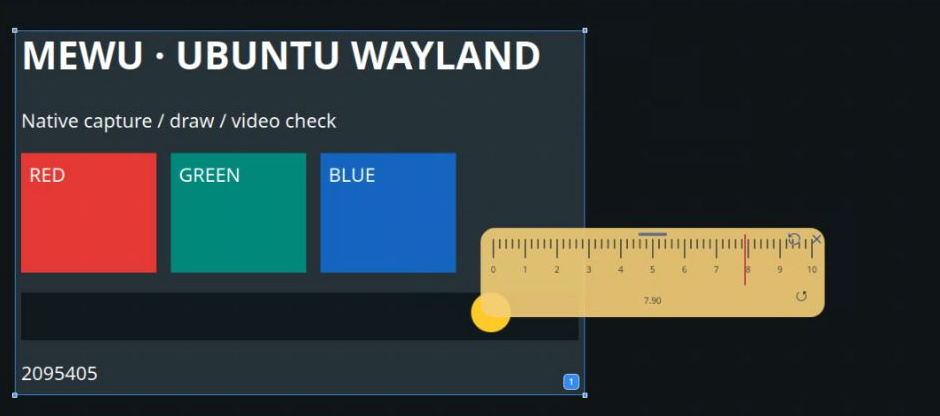

# 交互圆角尺

在空间中创建透明 HTML/SVG 圆角尺。拖动标记进行测量，使用对象顶部移动控件调整位置。

在空间工具中运行圆角尺；交互内容由插件提供，移动、刷新和关闭由 Mewu 对象层提供。

## 安装与开发

在 Mewu 的插件市场搜索 **交互圆角尺**，核对本项目源码后安装。已有版本的发行资产保留在[社区市场发行页](https://github.com/abnste/mewu-plugins/releases)，不变更用户现有的更新来源。

本仓库根目录的 mewu-plugin.json 与 index.mjs 是可独立打包的完整插件源码，无须修改 Mewu 核心。[SDK](https://github.com/abnste/mewu_ai/tree/next/packages/sdk) · [打包与 GitHub 投稿](https://github.com/abnste/mewu_ai/tree/next/tools/extension-market)

## 实际效果

插件 0.1.0 在 Ubuntu GNOME 原生应用中移动并交互后的截图，刻度已调为 7.90。截图来自早期预览分支实测；此插件的清单和入口代码与当前版本逐字节相同，不代表后续每个宿主版本均已验收。这里只裁去浏览器地址与外围桌面，未重绘或合成内容。

## 许可

MPL-2.0，与 Mewu 一致。
